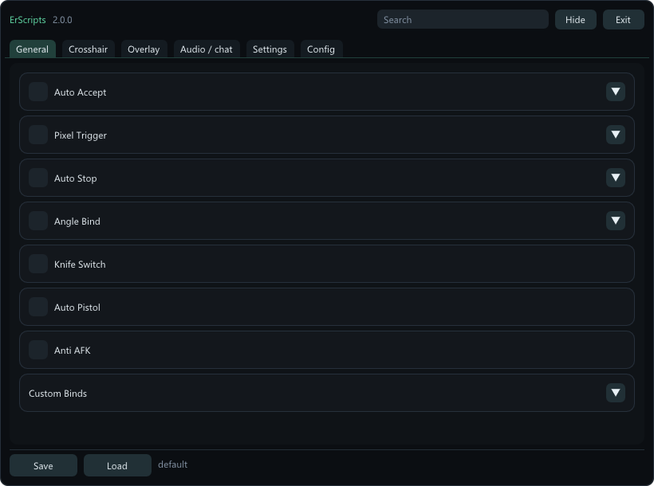
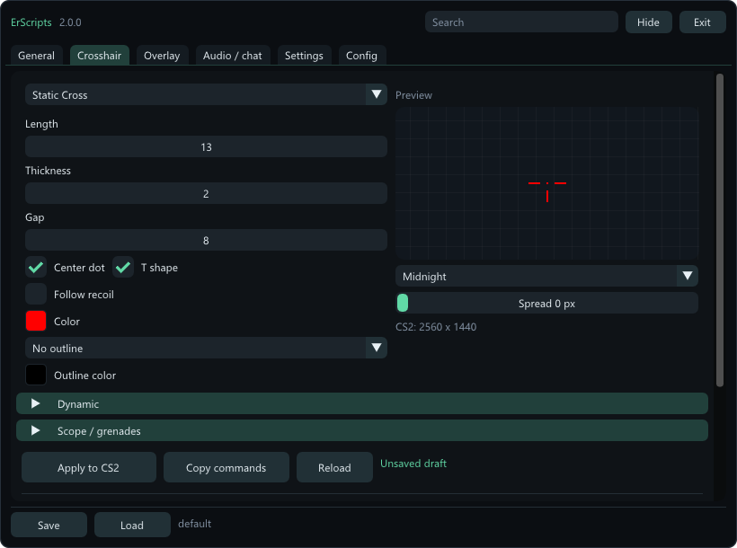
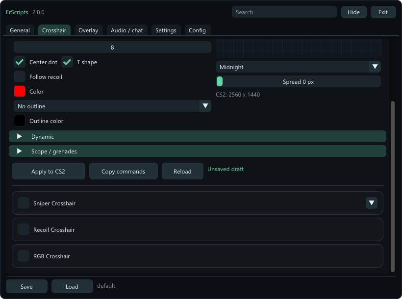
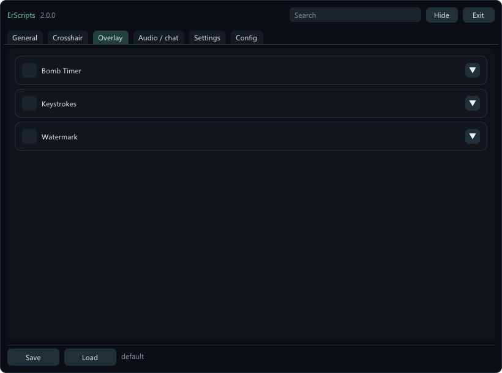
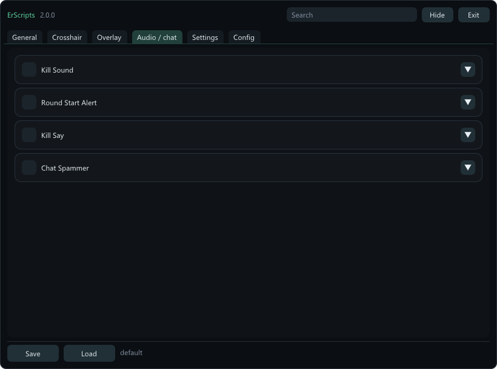
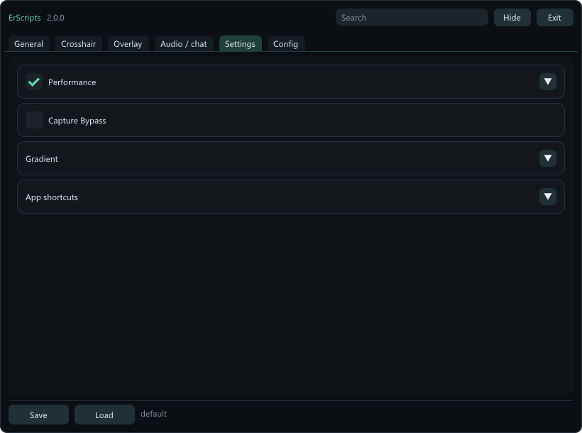
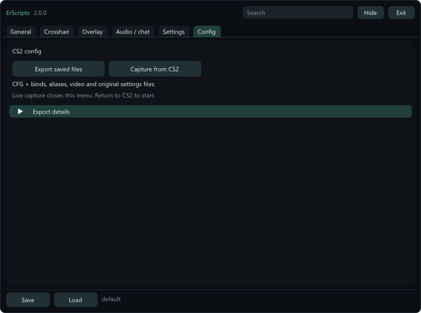
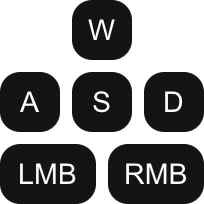

# ErScripts

Crosshairs, overlays and config backups for Counter-Strike 2. External, open source and built for Windows.

**[Download 2.0.0](https://github.com/emp0ry/cs2-ErScripts/releases/tag/v2.0.0)** · [Website](https://erscripts.emp0ry.com/) · [Report a bug](https://github.com/emp0ry/cs2-ErScripts/issues)



## What's new in 2.0.0

- Compact dark menu with search, six tabs and settings that expand per feature.
- Crosshair editor with ten styles, colors, outlines, scope and grenade controls, and a live preview.
- Sniper shot animation driven by your own GSI ammo changes, with separate profiles for AWP, SSG 08, SCAR-20 and G3SG1.
- Automatic resolution tracking and crosshair scaling when CS2's render size changes.
- Config export from saved files or a live CS2 capture.
- Consistent overlay colors, improved spacing and a default overlay limit of 120 FPS.

## Setup

1. Download `ErScripts.exe` from the release above and place it in a writable folder.
2. In Steam, open **Counter-Strike 2 > Properties > General** and add these launch options:

   ```text
   -conclearlog -condebug +bind scancode104 exec erscripts1
   ```

3. For the first run, start ErScripts before CS2 so it can create its config and GSI files. If CS2 is already open when those files are created, restart the game.
4. Press **Insert** to show or hide the menu. **End** exits. Change these keys in **Settings > App shortcuts**.

Use the arrow on a feature's right to open its settings. **Save** and **Load** use your local `configs/default.json` profile. For fullscreen overlays, leave **Disable fullscreen optimizations** unchecked in `cs2.exe` compatibility settings.

## Features

| Tab | Controls |
| --- | --- |
| General | Auto Accept, Pixel Trigger, Auto Stop, Angle Bind, Knife Switch, Auto Pistol, Anti AFK, Custom Binds |
| Crosshair | Crosshair editor, Sniper Crosshair, Recoil Crosshair, RGB Crosshair |
| Overlay | Bomb Timer, Keystrokes, Watermark |
| Audio / chat | Kill Sound, Round Start Alert, Kill Say, Chat Spammer |
| Settings | Performance, Capture Bypass, Gradient, App shortcuts |
| Config | Export saved files, Capture from CS2 |

### Crosshairs

Edit dimensions, colors and outlines, then choose **Apply to CS2** or **Copy commands**. Reload reads your saved CS2 crosshair. Dimensions use CS2's limits and resolution scaling; controls unused by the selected style are disabled.

Sniper animation uses only your active, living player's GSI data. Spectator data is ignored. Magazine decreases confirm shots; reloads, weapon changes and session changes reset the tracker. GSI does not expose exact shot timing, movement or aim punch, so dynamic behavior can differ from CS2. No game memory is read.

### Config backups

**Export saved files** backs up the active Steam account. **Capture from CS2** also reads exposed console variables, binds and aliases. Capture hides the menu; return to CS2 and wait for completion. **Open export folder** shows the result under `exports/`.

Exports include a generated `erscripts-export.cfg`, `settings.json`, original settings files, and detected local scripts. Video and machine settings are preserved as original files. To restore the generated CFG, copy it into `game/csgo/cfg` and run `exec erscripts-export` in CS2. Export does not apply settings automatically. Saved files can lag behind unsaved changes, and hidden engine state cannot be exported.

## Screenshots

All captures below are from 2.0.0. Click an image to open it at full size.

| Crosshair editor | Crosshair features |
| --- | --- |
|  |  |

| Overlay | Audio / chat |
| --- | --- |
|  |  |

| Settings | Config export |
| --- | --- |
|  |  |

| Bomb Timer | Keystrokes |
| --- | --- |
|  |  |

## Use responsibly

Auto Stop, Pixel Trigger, Angle Bind and Auto Pistol require an explicit risk acknowledgement each time you enable them. Loading a profile leaves them disabled. Automation can violate game, server or platform rules and lead to restrictions or bans. External operation does not guarantee safety or permission. ErScripts is not affiliated with Valve.

## Build

Requires Windows 10/11, Visual Studio with the C++ desktop workload, Windows SDK and the v143 toolset. The application uses C++20.

```powershell
git clone --recurse-submodules https://github.com/emp0ry/cs2-ErScripts.git
cd cs2-ErScripts
```

Open `ErScripts.sln`, select **Release | x64** and build. If you cloned without submodules, run `git submodule update --init --recursive` first.

Alternatively, use CMake 3.24 or newer from a Visual Studio Developer PowerShell with Ninja:

```powershell
cmake -S . -B build -G Ninja -DCMAKE_BUILD_TYPE=Release
cmake --build build
```

`--preview` opens the menu without CS2. `--no-update` keeps a local build from replacing itself with a published release.

Dependencies are pinned in `.gitmodules`: [Dear ImGui 1.91.5](https://github.com/ocornut/imgui), [JSON for Modern C++ 3.11.3](https://github.com/nlohmann/json), and [cpp-httplib 0.19.0](https://github.com/yhirose/cpp-httplib).

## Website

The GitHub Pages site is authored in [`website/src/`](website/src/) and published from `docs/`. Its shared EMP0RY design is specified in [`website/DESIGN.md`](website/DESIGN.md). Product releases should update the facts, screenshots and download links within that design.

```sh
cd website
npm ci
npm run dev
npm test
npm run build
npm run check:output
npm run preview
```

The build updates `docs/` while preserving the domain and release screenshot URLs. See [`website/README.md`](website/README.md) for maintenance and verification.

## License

[MIT](LICENSE.txt). Dependency licenses are included in their submodules. The website uses [Geist under the SIL Open Font License](docs/site/fonts/OFL.txt).

[Support the project](https://www.buymeacoffee.com/emp0ry) · [More by emp0ry](https://emp0ry.com/)
